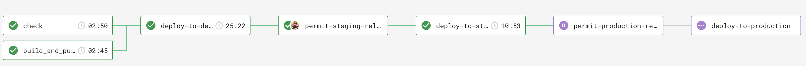

# Activity History API

## Overview

The Activity History API is an ASP.NET Core (.NET 8) Web API, owned by the London Borough of Hackney, that returns
the audit trail ("activity history") recorded against a given entity (the `targetId`, e.g. a person, tenure or
process). It is a read-only service: activity records are written to DynamoDB by other Hackney services, and this API
exposes them as a paged, newest-first list.

It runs as an AWS Lambda behind API Gateway in deployed environments ([LambdaEntryPoint.cs](ActivityHistoryApi/LambdaEntryPoint.cs))
and as a regular Kestrel web host locally or in Docker ([Program.cs](ActivityHistoryApi/Program.cs)).

## Stack

- .NET 8 / ASP.NET Core MVC controllers, `Startup`-style configuration ([Startup.cs](ActivityHistoryApi/Startup.cs)).
- AWS DynamoDB (via the AWS SDK object-persistence model and `Hackney.Core.DynamoDb`).
- AWS Lambda hosting (`Amazon.Lambda.AspNetCoreServer`), AWS X-Ray tracing, Serverless Framework deployment, Terraform for the table.
- Swashbuckle (Swagger/OpenAPI), `Microsoft.AspNetCore.Mvc.Versioning` (URL-segment versioning), FluentValidation.
- xUnit, FluentAssertions, Moq, AutoFixture and TestStack.BDDfy for tests.

## Key Functionality

| Feature | Description | Code |
|---|---|---|
| Activity history lookup | Returns activity records for a `targetId`, newest first (`createdAt` descending). | [ActivityHistoryController.cs](ActivityHistoryApi/V1/Controllers/ActivityHistoryController.cs) |
| Pagination | Default page size is 10 (`pageSize` overrides it). A `paginationToken` is returned only when further records exist (the gateway looks ahead by one record); send it back to fetch the next page. | [ActivityHistoryDbGateway.cs](ActivityHistoryApi/V1/Gateways/ActivityHistoryDbGateway.cs) |
| Health check | Pings DynamoDB to report service health. | [Startup.cs](ActivityHistoryApi/Startup.cs) |
| API versioning & Swagger | Version is read from the URL segment (default `1.0`); one Swagger document per `[ApiVersion]`; Swagger UI is enabled. | [Startup.cs](ActivityHistoryApi/Startup.cs), [Versioning/](ActivityHistoryApi/Versioning) |
| Cross-cutting concerns | Correlation ID, logging scope, global exception handler, X-Ray, `[LogCall]` method logging, permissive CORS. | [Startup.cs](ActivityHistoryApi/Startup.cs) |

## Endpoints

| Method | Route | Description |
|---|---|---|
| GET | `/api/v1/activityHistory` | Get paged activity history for a target. |
| GET | `/api/v1/healthcheck/ping` | Health check (DynamoDB). Registered with `MapHealthChecks` in [Startup.cs](ActivityHistoryApi/Startup.cs). |
| GET | `/swagger/index.html`, `/swagger/v1.0/swagger.json` | Swagger UI / OpenAPI document (UI paths exposed without authorizer in [serverless.yml](ActivityHistoryApi/serverless.yml)). |

### `GET /api/v1/activityHistory`

Declared in `ActivityHistoryApiController.GetByTargetIdAsync` ([ActivityHistoryController.cs](ActivityHistoryApi/V1/Controllers/ActivityHistoryController.cs)).

**Query parameters** (`GetActivityHistoryByTargetIdQuery`, from the `Hackney.Shared.ActivityHistory` NuGet package):

| Name | Type | Description |
|---|---|---|
| `targetId` | string (GUID in the tests) | Required. The entity whose history is returned. |
| `pageSize` | int, optional | Number of records per page; defaults to 10 when omitted. Upper bound: Unverified. |
| `paginationToken` | string, optional | Token from the previous response's `paginationDetails.nextToken`. |

**Response** (`200`): `PagedResult<ActivityHistoryResponseObject>` (`Hackney.Core.DynamoDb`) with a `results` array
and `paginationDetails` (`nextToken`, `hasNext`). The individual fields of `ActivityHistoryResponseObject`
live in the external `Hackney.Shared.ActivityHistory` package and are Unverified here.

| Status | Meaning |
|---|---|
| 200 | Records found. |
| 400 | Invalid query parameters (FluentValidation validator in the shared package; covered by the E2E "invalid target id" test). |
| 404 | No activity history for the `targetId`. |
| 500 | Unhandled error (via the custom exception middleware). |

**Authentication / authorization:** the controller has no `[Authorize]` attribute and the app configures no ASP.NET
authentication. Access control is applied at API Gateway by a Lambda authorizer on `/{proxy+}`
(`Authorization` header, [serverless.yml](ActivityHistoryApi/serverless.yml)); the Swagger definition documents an `X-Api-Key` header.
Locally there is no authentication.

## Data Sources

| Source | Usage | Evidence |
|---|---|---|
| DynamoDB table `ActivityHistory` | Only data store. Hash key `targetId`, range key `id`, local secondary index `ActivityHistoryByCreatedAt` (`targetId` + `createdAt`), TTL attribute `TimetoLiveForRecord`, pay-per-request billing. The gateway queries the index backwards (newest first) with consistent reads. | [ActivityHistoryDbGateway.cs](ActivityHistoryApi/V1/Gateways/ActivityHistoryDbGateway.cs), [terraform/](terraform) |
| AWS X-Ray | Request and AWS SDK call tracing. | [Startup.cs](ActivityHistoryApi/Startup.cs) |
| CloudWatch Logs | Lambda logging via `ConfigureLambdaLogging`. | [Startup.cs](ActivityHistoryApi/Startup.cs) |
| API Gateway Lambda authorizer | Authenticates callers before the Lambda is invoked. | [serverless.yml](ActivityHistoryApi/serverless.yml) |

The API does not write to DynamoDB (its IAM role does permit write actions, though). The producers of the data are not in this repo (Unverified).

## Architecture & Components

Single web project plus a test project (see [ActivityHistoryApi.sln](ActivityHistoryApi.sln)):

```
ActivityHistoryApi/              API project
  Program.cs                     Kestrel host (local/Docker)
  LambdaEntryPoint.cs            API Gateway proxy handler (AWS Lambda)
  Startup.cs                     DI registrations and middleware pipeline
  V1/Controllers/                ActivityHistoryApiController, BaseController
  V1/UseCase/                    IGetByTargetIdUseCase / GetByTargetIdUseCase
  V1/Gateways/                   IActivityHistoryGateway / ActivityHistoryDbGateway (DynamoDB)
  Versioning/                    Swagger/API version helpers
  serverless.yml                 Lambda, authorizer, IAM, VPC config
ActivityHistoryApi.Tests/        xUnit unit, gateway and E2E (BDDfy) tests
terraform/<env>/                 DynamoDB table per environment
```

Request flow: `Controller → IGetByTargetIdUseCase → IActivityHistoryGateway → DynamoDB`. The use case maps the
shared `ActivityHistoryEntity` domain objects to `ActivityHistoryResponseObject`s.

**DI lifetimes** ([Startup.cs](ActivityHistoryApi/Startup.cs)): `IActivityHistoryGateway` → `ActivityHistoryDbGateway` (scoped),
`IGetByTargetIdUseCase` → `GetByTargetIdUseCase` (scoped), `IApiVersionDescriptionProvider` (singleton). DynamoDB
(`ConfigureDynamoDB`), the token factory and the log-call aspect are registered by `Hackney.Core.*` extension methods (lifetimes Unverified).

**Middleware pipeline** (in order): CORS (any origin/header/method; exposes `x-correlation-id`) → developer exception page (Development) or HSTS →
correlation ID → logging scope → custom exception handler → X-Ray (`activity-history-api`) → Swagger UI / Swagger → routing →
endpoints (conventional default route and the health check) → `UseLogCall`.

Static analysis: both projects treat all analyzer warnings as errors (see [Static Code Analysis](#static-code-analysis)).

## Configuration

No user secrets or connection strings are used; DynamoDB is reached with the AWS SDK default credential chain.

| Setting | Where | Purpose |
|---|---|---|
| `DynamoDb:LocalMode` (env `DynamoDb_LocalMode`) | `appsettings*.json`, docker-compose, launchSettings | `true` targets a local DynamoDB instead of AWS. `false` in [appsettings.json](ActivityHistoryApi/appsettings.json). |
| `DynamoDb:LocalServiceUrl` (env `DynamoDb_LocalServiceUrl`) | [appsettings.DevelopmentLocal.json](ActivityHistoryApi/appsettings.DevelopmentLocal.json) | Local endpoint, e.g. `http://localhost:8000`. |
| `AWS:Region` / `AWS_REGION` | appsettings / env | `eu-west-2` in `appsettings.json`; `DefaultRegion` in `DevelopmentLocal`. |
| `AWS_ACCESS_KEY_ID`, `AWS_SECRET_ACCESS_KEY` | env | Any dummy value (`local`) for local DynamoDB (as in [docker-compose.yml](docker-compose.yml)). |
| `ASPNETCORE_ENVIRONMENT` | env | `DevelopmentLocal` for local runs ([launchSettings.json](ActivityHistoryApi/Properties/launchSettings.json)); in AWS read from SSM `/housing-tl/<stage>/aspnetcore-environment`. |
| `Logging:LogLevel`, `AllowedHosts` | appsettings | Standard ASP.NET Core settings. |
| `PORT` | env (Docker only) | Container port, default `3000`. |
| `LBHPACKAGESTOKEN` | env / docker build arg | GitHub Packages token used by [NuGet.Config](NuGet.Config) to restore the private `Hackney.*` packages. |
| `SONAR_TOKEN` | docker build arg (tests image) | SonarCloud scanner. |

X-Ray settings are read from `IConfiguration` by `AWSXRayRecorder.InitializeInstance`; no X-Ray keys are set in the repo.

## Getting Started

### Prerequisites

- [.NET 8 SDK](https://dotnet.microsoft.com/download/dotnet/8.0) (`net8.0`; there is no `global.json`).
- A `LBHPACKAGESTOKEN` environment variable containing a GitHub token with read access to the LBHackney-IT packages feed (required by `dotnet restore`).
- Docker, to run DynamoDB Local (and optionally the API/tests).

### Restore, build, run

```sh
export LBHPACKAGESTOKEN=<token>
docker run --name dynamodb-local -p 8000:8000 amazon/dynamodb-local        # local DynamoDB
dotnet restore
dotnet build
dotnet run --project ActivityHistoryApi                                     # http://localhost:5000
```

Running via `dotnet run` uses the `activity_history_api` launch profile, which sets `ASPNETCORE_ENVIRONMENT=DevelopmentLocal` and the local DynamoDB
variables. Create the `ActivityHistory` table (key and index as in [Data Sources](#data-sources)) in the local instance before calling the API.
Check `http://localhost:5000/api/v1/healthcheck/ping` and `http://localhost:5000/swagger`.

### Test

```sh
dotnet test
```

The E2E and gateway tests start a `WebApplicationFactory` and create the table themselves, but need DynamoDB Local on
`http://localhost:8000` (or `DynamoDb_LocalServiceUrl`). `docker-compose run activity-history-api-test` runs the suite in Docker against the `dynamodb-database` service.

## Contributing

### Setup

1. Install [Docker][docker-download].
2. Install [AWS CLI][AWS-CLI].
3. Clone this repository.
4. Open it in your IDE.

### Development

To serve the application, run it using your IDE of choice, we use Visual Studio CE and JetBrains Rider on Mac.

**Note**
When running locally a DynamoDB instance (see below) and the configuration in [Configuration](#configuration) are still needed.
##### DynamoDB
To use a local instance of DynamoDb, this will need to be installed. This is most easily done using [Docker](https://www.docker.com/products/docker-desktop).
Run the following command, specifying the local path where you want the container's shared volume to be stored.
```
docker run --name dynamodb-local -p 8000:8000 -v <PUT YOUR LOCAL PATH HERE>:/data/ amazon/dynamodb-local -jar DynamoDBLocal.jar -sharedDb -dbPath /data
```

If you would like to see what is in your local DynamoDb instance using a simple gui, then [this admin tool](https://github.com/aaronshaf/dynamodb-admin) can do that.

The application can also be served locally using docker:
1.  Add you security credentials to AWS CLI.
```sh
$ aws configure
```
2. Log into AWS ECR.
```sh
$ aws ecr get-login --no-include-email
```
3. Build and serve the application. It will be available in the port 3000.
```sh
$ make build && make serve
```

### Release process

We use a pull request workflow, where changes are made on a branch and approved by one or more other maintainers before the developer can merge into `master` branch.



Then we have an automated six step deployment process, which runs in CircleCI.

1. Automated tests (xUnit) are run to ensure the release is of good quality.
2. The application is deployed to development automatically, where we check our latest changes work well.
3. We manually confirm a staging deployment in the CircleCI workflow once we're happy with our changes in development.
4. The application is deployed to staging.
5. We manually confirm a production deployment in the CircleCI workflow once we're happy with our changes in staging.
6. The application is deployed to production.

Our staging and production environments are hosted by AWS. We would deploy to production per each feature/config merged into  `master`  branch.

### Creating A PR

To help with making changes to code easier to understand when being reviewed, we've added a PR template.
When a new PR is created on a repo that uses this API template, the PR template will automatically fill in the `Open a pull request` description textbox.
The PR author can edit and change the PR description using the template as a guide.

## Static Code Analysis

### Using [FxCop Analysers](https://www.nuget.org/packages/Microsoft.CodeAnalysis.FxCopAnalyzers)

FxCop runs code analysis when the Solution is built.

Both the API and Test projects have been set up to **treat all warnings from the code analysis as errors** and therefore, fail the build.

However, we can select which errors to suppress by setting the severity of the responsible rule to none, e.g `dotnet_analyzer_diagnostic.<Category-or-RuleId>.severity = none`, within the `.editorconfig` file.
Documentation on how to do this can be found [here](https://docs.microsoft.com/en-us/visualstudio/code-quality/use-roslyn-analyzers?view=vs-2019).

## Testing

### Run the tests

```sh
$ dotnet test
```

To run the database tests locally (e.g. via Visual Studio) DynamoDB Local must be running and `DynamoDb_LocalMode=true` / `DynamoDb_LocalServiceUrl` set (defaults `true` and `http://localhost:8000` are applied by [MockWebApplicationFactory.cs](ActivityHistoryApi.Tests/MockWebApplicationFactory.cs)).
In Docker the service URL is `http://dynamodb-database:8000` (see [docker-compose.yml](docker-compose.yml)).

Note: the `test` and `restart-db` targets in the [Makefile](Makefile) still reference a `test-database` compose service that no longer exists in `docker-compose.yml`; use `docker-compose run activity-history-api-test` or `dotnet test` instead.

### Agreed Testing Approach
- Use xUnit, FluentAssertions and Moq
- Always follow a TDD approach
- Tests should be independent of each other
- Gateway tests should interact with a real test instance of the database
- Test coverage should never go down
- All use cases should be covered by E2E tests
- Optimise when test run speed starts to hinder development
- Unit tests and E2E tests should run in CI
- Test database schemas should match up with production database schema
- Have integration tests which test from the DynamoDB table to API Gateway

## Data Migrations
### A good data migration
- Record failure logs
- Automated
- Reliable
- As close to real time as possible
- Observable monitoring in place
- Should not affect any existing databases

## Contacts

### Active Maintainers

- **Selwyn Preston**, Lead Developer at London Borough of Hackney (selwyn.preston@hackney.gov.uk)
- **Mirela Georgieva**, Lead Developer at London Borough of Hackney (mirela.georgieva@hackney.gov.uk)
- **Matt Keyworth**, Lead Developer at London Borough of Hackney (matthew.keyworth@hackney.gov.uk)

### Other Contacts

- **Rashmi Shetty**, Product Owner at London Borough of Hackney (rashmi.shetty@hackney.gov.uk)

[docker-download]: https://www.docker.com/products/docker-desktop
[universal-housing-simulator]: https://github.com/LBHackney-IT/lbh-universal-housing-simulator
[made-tech]: https://madetech.com/
[AWS-CLI]: https://aws.amazon.com/cli/
