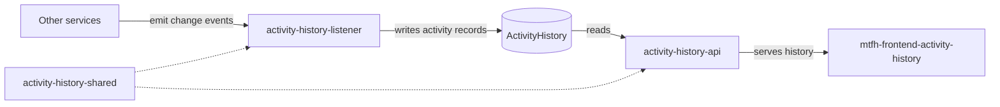

# Activity History API

The Activity History API is the London Borough of Hackney (LBH) **MTFH** service that exposes the
**activity/audit history for a target entity**. Other platform services publish domain events describing what
changed; this API returns the recorded history for a given `targetId`, newest first, with pagination.

It is a read-only, DynamoDB-backed API: it never creates, updates or deletes activity records.

## Tech stack

| Area | Technology |
| --- | --- |
| Runtime | **.NET 10** (`net10.0`), ASP.NET Core Web API |
| Hosting | **AWS Lambda** (`dotnet10` managed runtime) via `Amazon.Lambda.AspNetCoreServer`, in AWS region `eu-west-2` |
| API layer | Amazon **API Gateway** (`ANY /{proxy+}`) behind a request authorizer and the `Platform_APIs_Web_ACL` WAF |
| Datastore | **DynamoDB** table `ActivityHistory`, accessed via the `Hackney.Core.DynamoDb` and `Hackney.Shared.ActivityHistory` packages |
| Infrastructure | **Terraform** (DynamoDB table, VPC/subnets, security group) per environment under [`terraform/`](terraform) |
| Deployment | **Serverless Framework** ([`serverless.yml`](ActivityHistoryApi/serverless.yml)) driven by **CircleCI** |
| Observability | **AWS X-Ray** tracing, `Hackney.Core.Logging` structured logging |
| API docs | **Swashbuckle** (Swagger/OpenAPI), one document per API version |
| Cross-cutting | `Hackney.Core.*` packages (DynamoDB, health checks, JWT, logging, middleware, validation), FluentValidation for request validation, MVC API versioning (URL segment reader), `System.Text.Json` with web defaults (camelCase) plus `JsonStringEnumConverter` (enums emitted as strings) |
| Testing | xUnit, `TestStack.BDDfy`, FluentAssertions, Moq, AutoFixture, `Microsoft.AspNetCore.Mvc.Testing` |

## Endpoints

Versioning uses `UrlSegmentApiVersionReader` with `DefaultApiVersion = 1.0` and
`AssumeDefaultVersionWhenUnspecified = true`. Only v1 exists.

| Verb | Route | Request (model) | Response (model) | Summary |
| --- | --- | --- | --- | --- |
| GET | `/api/v1/activityHistory` | `GetActivityHistoryByTargetIdQuery` — query string: `targetId` (**required**, `Guid`), `paginationToken` (optional), `pageSize` (optional, defaults to 10) | `200 OK` → `PagedResult<ActivityHistoryResponseObject>` — `{ "results": [...], "paginationDetails": { "hasNext": bool, "nextToken": string\|null } }` | Returns the recorded activity history for the supplied `targetId`, newest first and paginated via the `ActivityHistoryByCreatedAt` index. Returns `404` when no history exists for the target, `400` on validation failure and `500` on error. |
| GET | `/api/v1/healthcheck/ping` | — | Health report written by `HealthCheckResponseWriter` | Unversioned liveness/readiness probe (mapped outside MVC); includes a DynamoDB health check. |
| GET | `/swagger` | — | OpenAPI document / Swagger UI | Interactive API documentation with one document per API version; declares the `X-Api-Key` security requirement for API calls. |

An activity history record (`ActivityHistoryResponseObject`) contains `Id`, `TargetId`, `TargetType`, `Type`,
`CreatedAt`, `AuthorDetails { FullName, Email }`, `NewData`, `OldData` and `SourceDomain`.

Served through API Gateway, the activity history and health endpoints sit behind the request authorizer;
`GET /swagger/{proxy+}` is public. Swagger declares an `X-Api-Key` security scheme for API calls.

## Related repositories

This service is one of several repositories that make up the activity history feature. Other services across
the platform emit events when their data changes; the listener turns those events into activity records, they
are stored in one shared history, and this API serves that history back.

| Repository | Summary |
| --- | --- |
| [activity-history-api](https://github.com/LBHackney-IT/activity-history-api) | **Serves the history.** This repository — a read-only HTTP API over the recorded activity for a given entity. |
| [activity-history-listener](https://github.com/LBHackney-IT/activity-history-listener) | **Builds the history.** An AWS Lambda that consumes events published by other services and writes the corresponding activity records to DynamoDB. |
| [activity-history-shared](https://github.com/LBHackney-IT/activity-history-shared) | **Defines the history.** The `Hackney.Shared.ActivityHistory` NuGet package (domain entity, request/response models, factories) used by both the API and the listener so records are written and read consistently. |
| [mtfh-frontend-activity-history](https://github.com/LBHackney-IT/mtfh-frontend-activity-history) | **Displays the history.** The MTFH micro-frontend that calls this API to render an entity's activity timeline. |

## Data sources and external dependencies

| Source | Summary |
| --- | --- |
| DynamoDB table `ActivityHistory` | The only data store. Read via `ActivityHistoryDbGateway` using the local secondary index `ActivityHistoryByCreatedAt` (range key `createdAt`, newest first). Keys: `targetId` (HASH) + `id` (RANGE); TTL attribute `TimetoLiveForRecord`; `PAY_PER_REQUEST` billing; point-in-time recovery enabled. Defined identically per environment in [`terraform/*/dynamodb.tf`](terraform). |
| DynamoDB Local (`amazon/dynamodb-local`) | Local emulator on port 8000, supplied by [`docker-compose.yml`](docker-compose.yml) for development and tests (`DynamoDb_LocalMode=true`). |
| Amazon API Gateway | Fronts the Lambda: `ANY /{proxy+}` and `GET /swagger/{proxy+}`, CORS, request authorizer (`api-gateway-lambda-authorizer`) and the `Platform_APIs_Web_ACL` WAF. |
| AWS X-Ray | Tracing of inbound requests (`app.UseXRay("activity-history-api")`) and AWS SDK calls (`AWSSDKHandler.RegisterXRayForAllServices()`), configured with `AWSXRayRecorder.InitializeInstance/RegisterLogger`; the Lambda role has `AWSXRayDaemonWriteAccess`. |
| AWS SSM Parameter Store | `/housing-tl/{stage}/aspnetcore-environment` supplies the Lambda's `ASPNETCORE_ENVIRONMENT` (declared in [`serverless.yml`](ActivityHistoryApi/serverless.yml)); `/housing-tl/{stage}/cloudwatch-alarms-topic-arn` is read by the Terraform `api-alarm` module. |
| AWS IAM / CloudWatch Logs | The Lambda role grants DynamoDB `BatchGet*`, `BatchWrite`, `DeleteItem`, `DescribeStream`, `DescribeTable`, `Get*`, `PutItem`, `Query`, `Scan` and `UpdateItem` on `table/ActivityHistory` and `table/ActivityHistory/index/*`, plus logging to `/aws/lambda/*`. |
| Terraform S3 backend | Remote state buckets only; the application itself does not use S3. |

There are no outbound HTTP calls to other services — the API only reads DynamoDB. `database.env` is a stale
template leftover and is not used (this service has no SQL database).

## Contributing

Build, run, test and deployment instructions live in [CONTRIBUTION.md](CONTRIBUTION.md).

## Contacts

**Housing product team** — [mmh-project-team@hackney.gov.uk](mailto:mmh-project-team@hackney.gov.uk)
